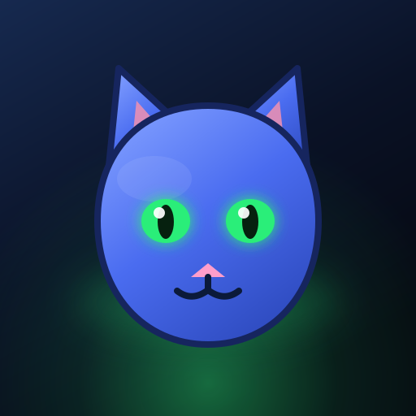

<p align="center">
  
</p>

<h1 align="center">Shadow Paw: Neon Mission</h1>

<p align="center">A fast-paced neon platformer adventure where you play as a cat on a mission to save the day!</p>

<p align="center">
  <a href="https://shadow-paw-game.vercel.app"><strong>🚀 Play Now on Vercel</strong></a>
</p>

[](https://shadow-paw-game.vercel.app)
[](LICENSE)
[](https://github.com/RobinAyzit/Shadow-Paw/stargazers)

---

## 🎮 About

Shadow Paw: Neon Mission is an exciting neon-themed platformer game where you control a cat navigating through a vibrant cyberpunk city. Collect fish, defeat enemies, avoid traps, and reach the goal!

### Features

- 🎯 **40 Action-Packed Levels** - Eight five-level chapters, each ending in a boss
- 🌑 **Shadow Shift** - Charge the meter with fish, kills and near misses, then press `E` (or tap the meter): four seconds of invulnerability, +30 % speed, a fish magnet, +75 % score and enemies dissolve when you run through them
- 🧠 **Learnable Levels** - Every stage is generated from a fixed seed, so a retry replays the exact same course instead of a fresh dice roll
- 📅 **Daily Run & Ghost** - One shared date seed for everyone, a local top-10 per day, a play streak and a translucent ghost of your best run on that exact seed
- 🚩 **Checkpoints** - Two cyan beacons on long stages send a fallen cat back to safe ground while keeping collected fish and score; no free lives
- 🎚️ **Difficulty** - Avslappnat / Normal / Utmaning scales pits, enemies, hazards, the fish quota and the Speed Run clock, never rewards
- 👾 **Distinct Enemies** - Hounds chase, skittish foes feint and retreat, hoppers keep a vertical rhythm; shadow wraiths can only be dissolved by a Shadow Shift pass
- 👑 **Boss Depth** - A miniboss on every third chapter, an exposed glowing core after each attack (double damage), double damage on a Shadow Shift pass, and longer-telegraphed phase-3 crossfire and spiral patterns
- 🃏 **Risk/Reward Cards** - Choose 1 of 3 seeded cards between levels; every card has both an upside and a cost, and restarting never rerolls the offer
- 🎧 **Adaptive Audio & Haptics** - Combo-driven music layers, ducking under boss warnings, enemy-position stereo panning and a distinct vibration signature per event
- ⚡ **Auto Quality** - Measures real frame time, trims particles and weather, caches the static skyline offscreen and makes bloom/atmosphere optional
- ❤️ **Fair Campaigns** - Clearing a level restores a life (two for a flawless or boss clear), and the intro card can be skipped with any key or tap
- 🗺️ **Chapter Map** - See your progress, jump back into any cleared level
- 💾 **Campaign Checkpoint** - Continue from the highest chapter you have unlocked
- 🌍 **Five Languages** - English, Swedish, Turkish, Spanish and Arabic (with full RTL layout)
- 🐱 **Play as a Cat** - Control your feline hero through neon streets
- 🐰 **Defeat Enemies** - Jump on enemies or shoot them from a distance
- 🐟 **Collect Fish** - Gather fish, extend the timer and earn coins
- 💰 **Shop System** - Upgrade your cat with better stats
- 📱 **Mobile Support** - Hold-to-fire touch controls, portrait and landscape
- 🌅 **Living Skies** - Dawn, sunset, rain, snow, storms and firefly nights
- 🎵 **Epic Soundtrack** - Background music and sound effects
- ♿ **Comfort Options** - Reduced motion, colour-blind mode, text and UI scaling

---

## 🧪 Quality checks

```bash
npm run check         # TypeScript, translation table and production build
npm run test:units    # pure level/difficulty/perk/quality/daily/telemetry tests
npm run dev           # http://localhost:3000  (needed for the browser suites)
npm run test:smoke    # headless gameplay test against the running dev server
npm run test:ui       # pause, results, game over, shop and all 5 languages / RTL
```

Requires Node 22+ (the unit runner uses native TypeScript stripping).
All three suites run in `.github/workflows/deploy-pages.yml` before a deploy.
`test:smoke` drives the real game and verifies deterministic level generation,
a reachable fish quota, checkpoints, seeded perk offers, the miniboss, wraith
immunity, intro skipping, the life refill and the whole Shadow Shift lifecycle.
`test:ui` covers pause/results/game over/shop plus all five languages including
Arabic RTL and the shared daily seed. `test:units` needs no browser at all.

Every harness shares `scripts/browser.mjs`: it uses `CHROME_PATH` (or `--chrome`)
if you have a local Chrome, otherwise the Chromium bundled with
`@sparticuz/chromium` - no Windows-only paths, so CI works out of the box. Set
`BASE_URL` to test a deploy, and `FAST_CANVAS=0` to keep real canvas painting
(much slower in headless).

### Architecture

The game loop lives in `components/Views.tsx`, with pure, unit-testable modules
under `game/`: `level.ts` (seeds, layouts, difficulty, weather, checkpoints),
`types.ts` (real `GameState` / `HudStats` instead of `any`), `enemies.ts`,
`perks.ts`, `daily.ts`, `quality.ts`, `telemetry.ts` and `haptics.ts`. HUD and
canvas helpers are split into `components/GameHud.tsx` and
`components/gameRender.ts`.

---

## 🛠️ Technology Stack

- **Frontend:** React 19 + TypeScript
- **Styling:** Tailwind CSS
- **Game Engine:** HTML5 Canvas
- **Audio:** Web Audio API
- **Deployment:** Vercel

---

## 📸 Screenshots

<div align="center">
  
  
  
</div>

---

## 🤝 Contributing

We love contributions! Whether it's fixing a bug, adding a feature, or improving documentation:

1. **Fork** the project.
2. **Create** your Feature Branch (`git checkout -b feature/AmazingFeature`)
3. **Commit** your changes (`git commit -m 'Add some AmazingFeature'`)
4. **Push** to the branch (`git push origin feature/AmazingFeature`)
5. **Open** a Pull Request.

---

## 📋 License

MIT License

Copyright (c) 2026 nRn World

Permission is hereby granted, free of charge, to any person obtaining a copy of this software and associated documentation files (the "Software"), to deal in the Software without restriction, including without limitation the rights to use, copy, modify, merge, publish, distribute, sublicense, and/or sell copies of the Software, and to permit persons to whom the Software is furnished to do so, subject to the following conditions:

The above copyright notice and this permission notice shall be included in all copies or substantial portions of the Software.

THE SOFTWARE IS PROVIDED "AS IS", WITHOUT WARRANTY OF ANY KIND, EXPRESS OR IMPLIED, INCLUDING BUT NOT LIMITED TO THE WARRANTIES OF MERCHANTABILITY, FITNESS FOR A PARTICULAR PURPOSE AND NONINFRINGEMENT. IN NO EVENT SHALL THE AUTHORS OR COPYRIGHT HOLDERS BE LIABLE FOR ANY CLAIM, DAMAGES OR OTHER LIABILITY, WHETHER IN AN ACTION OF CONTRACT, TORT OR OTHERWISE, ARISING FROM, OUT OF OR IN CONNECTION WITH THE SOFTWARE OR THE USE OR OTHER DEALINGS IN THE SOFTWARE.

---

👨‍💻 **Author**  
Created 2026 by © nRn World

📧 bynrnworld@gmail.com

## 🙏 Support

If you like this project, consider:

* ⭐ Star the project on GitHub  
* ☕ **Support development**: [Buy me a coffee 💜](https://ko-fi.com/nrnworld)  
* 📢 Share with your friends

Created by ❤️ © nRn World
